 
<h2 >Lenguajes de programación y Frameworks</h2>
<!--tech stack icons-->

  <a href="https://skillicons.dev">
     
       
    
  </a>

 
<!-------------------------->

<h2 >Tecnologías y otras herramientas</h2>
<!--tech stack icons-->

  

 
<!-------------------------->

<h2>GitHub</h2>
<!--- stats & Trophy (start) -->

  <!--- stats (start) -->
  <table align="left">
    <tr border="none">
      <td width="60%" align="center">

  
    
   
      </td>

  <td width="40%" align="center">

  

  </td>
    </tr>
  </table>
<!--- stats (end) -->
